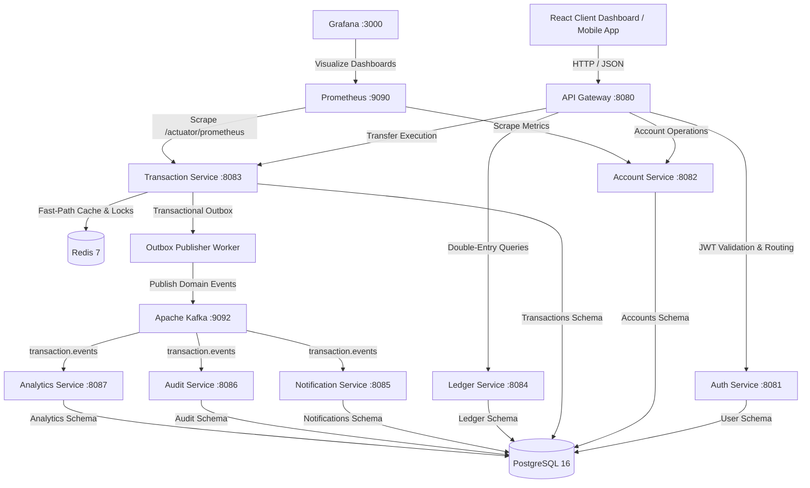

# System Architecture Document — Atomic-Pay

## Overview

**Atomic-Pay** is a production-grade, distributed digital banking and wallet backend platform designed for extreme reliability, idempotency, strict monetary consistency, event-driven processing, and comprehensive observability.

---

## Core Architectural Guarantees

1. **Monetary Precision**: All monetary values are represented using PostgreSQL `NUMERIC(19,4)` and Java `BigDecimal`. Floating-point types (`float`/`double`) are strictly prohibited.
2. **Immutable Double-Entry Ledger**: Every balance mutation produces paired, append-only debit and credit ledger entries balancing to zero (`DEBIT + CREDIT = 0`).
3. **Database Authority**: PostgreSQL is the immutable source of truth for accounts, ledger entries, and transaction history. Redis serves strictly as a fast-path cache/idempotency/lock coordinator.
4. **Guaranteed Idempotency**: Dual protection using Redis fast-path and PostgreSQL database unique constraints `UNIQUE(user_id, idempotency_key)` and payload hash checking.
5. **Transactional Outbox**: Events are written atomically into PostgreSQL `transactions.outbox_events` in the same database transaction as financial mutations, avoiding DB/Kafka dual-write anomalies.
6. **Idempotent Consumers**: Every Kafka consumer tracks processed events in `processed_events(consumer_name, event_id)` to handle duplicate messages safely.

---

## Service Boundaries & Responsibilities

- **API Gateway (`gateway`)**: Public entry point, JWT verification, rate limiting, correlation ID injection (`X-Correlation-ID`), request routing.
- **Auth Service (`auth-service`)**: User registration, authentication, JWT access/refresh token issuance, KYC verification status.
- **Account Service (`account-service`)**: User account management, currency verification, balance queries, optimistic versioning, row-level locking (`SELECT ... FOR UPDATE`).
- **Transaction Service (`transaction-service`)**: Core transfer execution, transaction state machine, Saga orchestration, idempotency checking, failure compensation, outbox publishing.
- **Ledger Service (`ledger-service`)**: Immutable double-entry bookkeeping, ledger account tracking, balance audit verification.
- **Notification Service (`notification-service`)**: Event-driven notification generation for transaction completion/failure with inbox deduplication.
- **Audit Service (`audit-service`)**: Immutable event audit log persistence with inbox deduplication.
- **Analytics Service (`analytics-service`)**: Aggregate system transaction metrics and event streaming.
