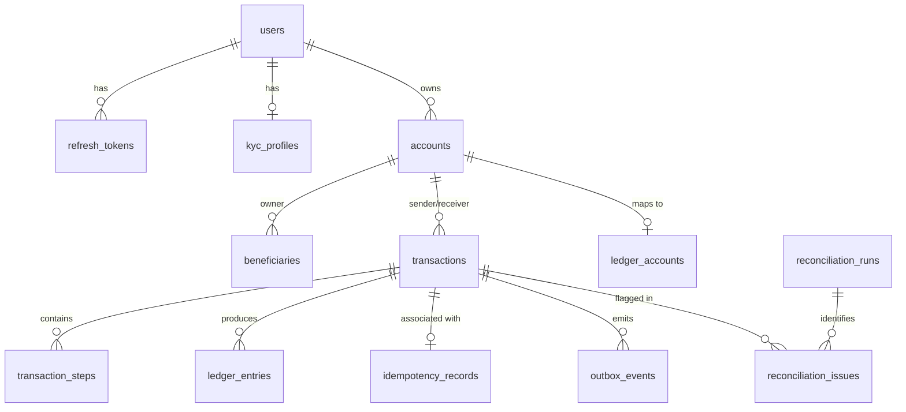

# Database Design & Schema Specification — Atomic-Pay

## Schema Isolation Strategy

To enforce clean microservice data boundaries while ensuring simple local container deployment, all microservices share a single PostgreSQL 16 database instance but read and write exclusively to isolated database schemas:

- `auth`: User authentication, credentials, refresh tokens, KYC profiles.
- `accounts`: Wallet accounts, currency balances, beneficiaries.
- `transactions`: Transfers, Saga steps, idempotency records, transactional outbox events, reconciliation runs & issues.
- `ledger`: Double-entry ledger accounts and immutable ledger entries.
- `notifications`: User notifications and consumer inbox state (`processed_events`).
- `audit`: Immutable system audit logs and consumer inbox state (`processed_events`).
- `analytics`: Aggregated system metrics and consumer inbox state (`processed_events`).

---

## Entity Relationship Diagram (ERD)

---

## Complete Table Schema Definitions

### 1. `auth.users`
| Column | Type | Constraints | Description |
|---|---|---|---|
| `id` | UUID | PRIMARY KEY | Unique user identifier |
| `email` | VARCHAR(255) | UNIQUE, NOT NULL | User login email |
| `password_hash` | TEXT | NOT NULL | BCrypt hashed password |
| `full_name` | VARCHAR(120) | NOT NULL | User display name |
| `phone` | VARCHAR(20) | NULL | Contact phone number |
| `role` | VARCHAR(30) | NOT NULL | `USER`, `ADMIN`, `AUDITOR` |
| `status` | VARCHAR(30) | NOT NULL | `ACTIVE`, `SUSPENDED`, `LOCKED`, `CLOSED` |
| `created_at` | TIMESTAMPTZ | NOT NULL | Creation timestamp |
| `updated_at` | TIMESTAMPTZ | NOT NULL | Last update timestamp |

### 2. `accounts.accounts`
| Column | Type | Constraints | Description |
|---|---|---|---|
| `id` | UUID | PRIMARY KEY | Unique account identifier |
| `user_id` | UUID | NOT NULL | Account owner reference |
| `account_number` | VARCHAR(32) | UNIQUE, NOT NULL | Display account number |
| `currency` | CHAR(3) | DEFAULT 'INR' | ISO 4217 Currency code |
| `account_type` | VARCHAR(30) | NOT NULL | `SAVINGS`, `CHECKING`, `BUSINESS` |
| `status` | VARCHAR(30) | NOT NULL | `ACTIVE`, `FROZEN`, `CLOSED` |
| `current_balance` | NUMERIC(19,4) | DEFAULT 0, CHECK (>= 0) | Available balance |
| `version` | BIGINT | DEFAULT 0 | Optimistic locking version |
| `created_at` | TIMESTAMPTZ | NOT NULL | Creation timestamp |
| `updated_at` | TIMESTAMPTZ | NOT NULL | Last update timestamp |

### 3. `transactions.transactions`
| Column | Type | Constraints | Description |
|---|---|---|---|
| `id` | UUID | PRIMARY KEY | Unique transaction identifier |
| `idempotency_key` | VARCHAR(255) | NOT NULL | Request idempotency key |
| `sender_account_id` | UUID | NOT NULL | Debited account reference |
| `receiver_account_id` | UUID | NOT NULL | Credited account reference |
| `amount` | NUMERIC(19,4) | NOT NULL, CHECK (> 0) | Transfer monetary amount |
| `currency` | CHAR(3) | NOT NULL | Currency code |
| `status` | VARCHAR(40) | NOT NULL | State machine status |
| `failure_code` | VARCHAR(80) | NULL | Failure error code |
| `failure_reason` | TEXT | NULL | Human-readable failure explanation |
| `correlation_id` | VARCHAR(100) | NULL | Distributed trace correlation ID |
| `version` | BIGINT | DEFAULT 0 | Version number |
| `created_at` | TIMESTAMPTZ | NOT NULL | Timestamp initiated |
| `updated_at` | TIMESTAMPTZ | NOT NULL | Timestamp updated |
| `completed_at` | TIMESTAMPTZ | NULL | Timestamp finalized |
| Constraint | UNIQUE | `(sender_account_id, idempotency_key)` | Database idempotency guard |
| Constraint | CHECK | `(sender_account_id <> receiver_account_id)` | Prevent self-transfers |

### 4. `ledger.ledger_entries`
| Column | Type | Constraints | Description |
|---|---|---|---|
| `id` | UUID | PRIMARY KEY | Unique entry identifier |
| `transaction_id` | UUID | NOT NULL | Associated transaction ID |
| `ledger_account_id` | UUID | NOT NULL REFERENCES `ledger_accounts(id)` | Ledger account reference |
| `entry_type` | VARCHAR(10) | NOT NULL, CHECK (`DEBIT`, `CREDIT`) | Entry debit or credit type |
| `amount` | NUMERIC(19,4) | NOT NULL, CHECK (> 0) | Entry monetary amount |
| `currency` | CHAR(3) | NOT NULL | Currency code |
| `sequence_no` | INT | NOT NULL | Pair sequence (1=DEBIT, 2=CREDIT) |
| `created_at` | TIMESTAMPTZ | NOT NULL | Entry timestamp |
| Constraint | UNIQUE | `(transaction_id, sequence_no)` | Pair uniqueness constraint |
