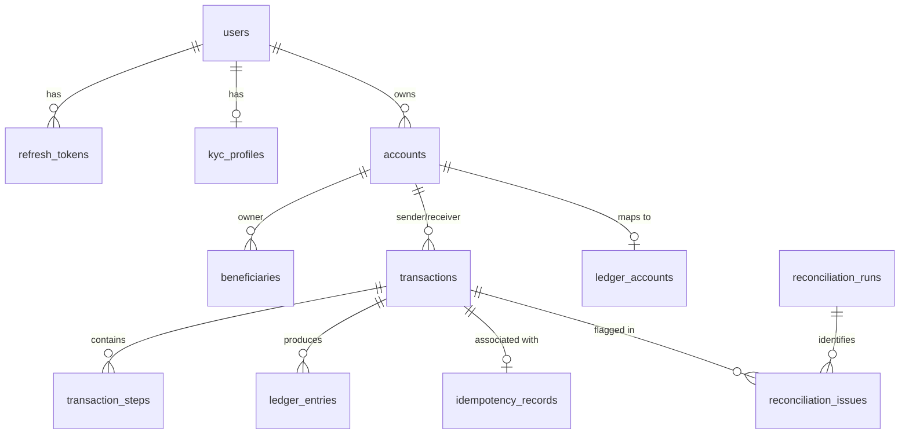

# Database Design Document

## Schema Separation Strategy

To maintain clean microservice boundaries while ensuring simple local development, all microservices share a single PostgreSQL database instance but write exclusively to isolated schemas:

- `auth`: User authentication, credentials, refresh tokens, KYC.
- `accounts`: Wallet accounts, currency balances, beneficiaries.
- `transactions`: Transfers, Saga steps, idempotency records, transactional outbox, reconciliation runs/issues.
- `ledger`: Double-entry ledger accounts and immutable ledger entries.
- `audit`: Immutable system audit logs and consumer inbox state.
- `notifications`: User notifications and consumer inbox state.
- `analytics`: Aggregated system metrics and consumer inbox state.

## Entity Relationship Model

## Detailed Schema Definitions

### 1. `auth.users`
| Column | Type | Constraints |
|--------|------|-------------|
| id | UUID | PRIMARY KEY |
| email | VARCHAR(255) | UNIQUE, NOT NULL |
| password_hash | TEXT | NOT NULL |
| full_name | VARCHAR(120) | NOT NULL |
| phone | VARCHAR(20) | NULL |
| role | VARCHAR(30) | NOT NULL (`USER`, `ADMIN`, `AUDITOR`) |
| status | VARCHAR(30) | NOT NULL (`ACTIVE`, `SUSPENDED`, `LOCKED`, `CLOSED`) |
| created_at | TIMESTAMPTZ | NOT NULL |
| updated_at | TIMESTAMPTZ | NOT NULL |

### 2. `accounts.accounts`
| Column | Type | Constraints |
|--------|------|-------------|
| id | UUID | PRIMARY KEY |
| user_id | UUID | NOT NULL |
| account_number | VARCHAR(32) | UNIQUE, NOT NULL |
| currency | CHAR(3) | DEFAULT 'INR', CHECK (currency = 'INR') |
| account_type | VARCHAR(30) | NOT NULL |
| status | VARCHAR(30) | NOT NULL |
| current_balance | NUMERIC(19,4) | DEFAULT 0, CHECK (current_balance >= 0) |
| version | BIGINT | DEFAULT 0 |
| created_at | TIMESTAMPTZ | NOT NULL |
| updated_at | TIMESTAMPTZ | NOT NULL |

### 3. `transactions.transactions`
| Column | Type | Constraints |
|--------|------|-------------|
| id | UUID | PRIMARY KEY |
| idempotency_key | VARCHAR(255) | NOT NULL |
| sender_account_id | UUID | NOT NULL |
| receiver_account_id | UUID | NOT NULL |
| amount | NUMERIC(19,4) | NOT NULL, CHECK (amount > 0) |
| currency | CHAR(3) | NOT NULL |
| status | VARCHAR(40) | NOT NULL |
| failure_code | VARCHAR(80) | NULL |
| failure_reason | TEXT | NULL |
| correlation_id | VARCHAR(100) | NULL |
| version | BIGINT | DEFAULT 0 |
| created_at | TIMESTAMPTZ | NOT NULL |
| updated_at | TIMESTAMPTZ | NOT NULL |
| completed_at | TIMESTAMPTZ | NULL |
| | | UNIQUE(sender_account_id, idempotency_key) |
| | | CHECK (sender_account_id <> receiver_account_id) |

### 4. `ledger.ledger_entries`
| Column | Type | Constraints |
|--------|------|-------------|
| id | UUID | PRIMARY KEY |
| transaction_id | UUID | NOT NULL |
| ledger_account_id | UUID | NOT NULL REFERENCES ledger_accounts(id) |
| entry_type | VARCHAR(10) | NOT NULL, CHECK (entry_type IN ('DEBIT', 'CREDIT')) |
| amount | NUMERIC(19,4) | NOT NULL, CHECK (amount > 0) |
| currency | CHAR(3) | NOT NULL |
| sequence_no | INT | NOT NULL |
| created_at | TIMESTAMPTZ | NOT NULL |
| | | UNIQUE(transaction_id, sequence_no) |
