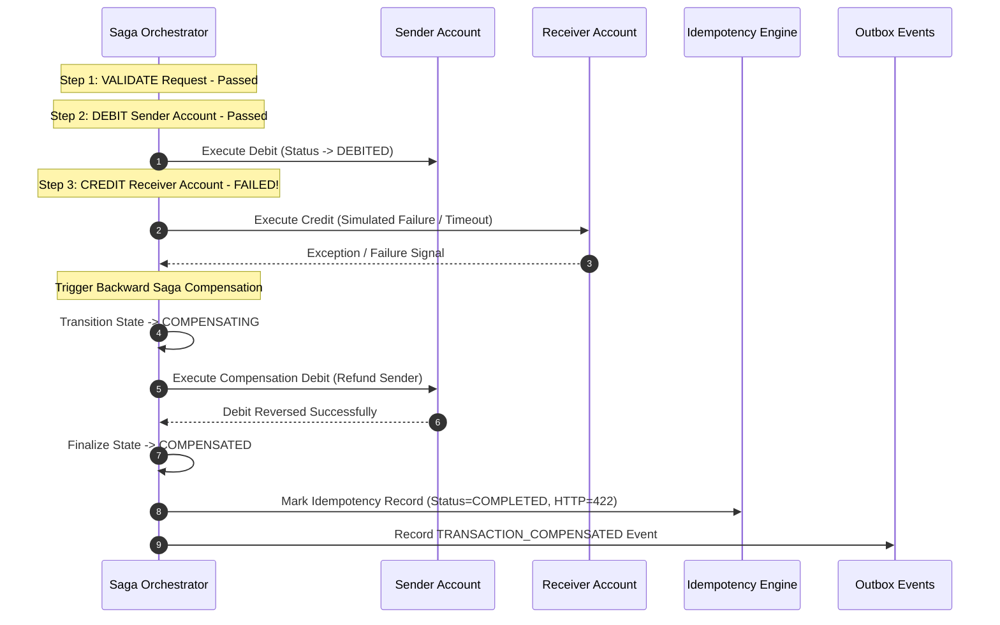
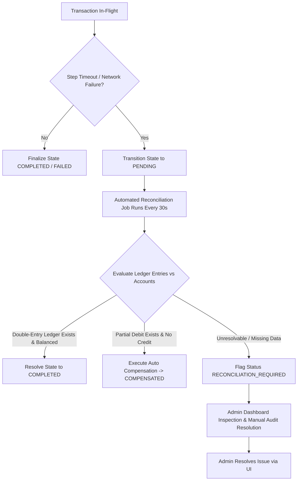
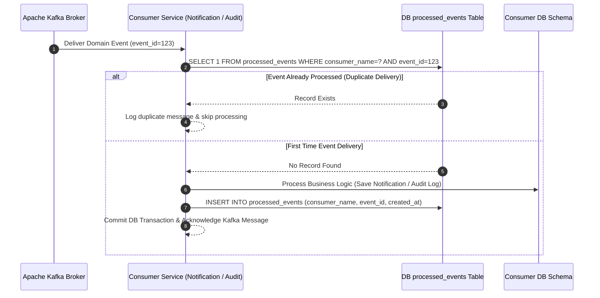

# Failure Recovery, Saga Compensation, & Reconciliation — Atomic-Pay

## 1. Saga Failure Handling & Backward Compensation

When a multi-step transaction fails midway (e.g., credit operation to receiver fails after sender has been debited), the distributed Saga engine initiates backward step-by-step compensation to restore balance integrity.

---

## 2. Uncertain Outcome Handling & Reconciliation Workflow

---

## 3. Idempotent Consumer Deduplication (Inbox Pattern)

