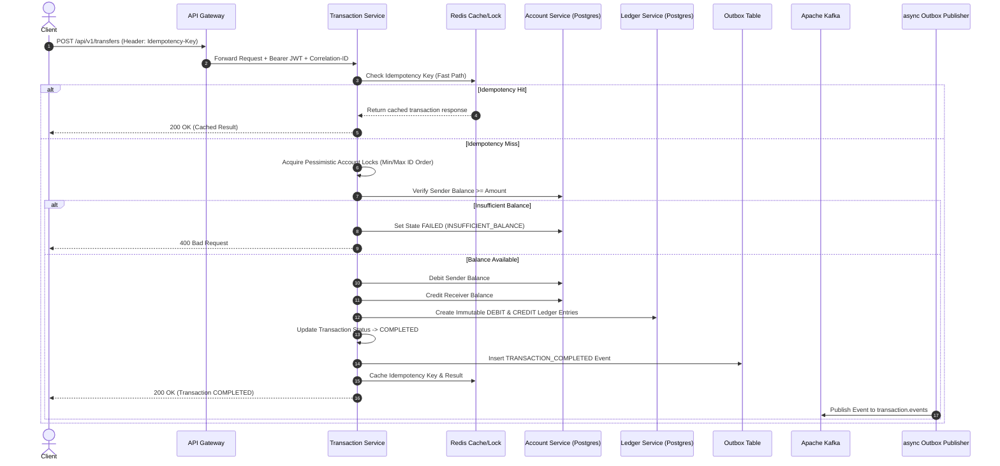

# Transaction Lifecycle & Execution Flow

## 1. High-Level Transfer Sequence



## 2. Transaction State Transitions

```
INITIATED -> VALIDATING
VALIDATING -> PROCESSING
VALIDATING -> FAILED

PROCESSING -> DEBITED
PROCESSING -> PENDING
PROCESSING -> FAILED

DEBITED -> CREDITED
DEBITED -> COMPENSATING
DEBITED -> PENDING

CREDITED -> COMPLETED
CREDITED -> PENDING

COMPENSATING -> COMPENSATED
COMPENSATING -> PENDING

PENDING -> COMPLETED
PENDING -> FAILED
PENDING -> RECONCILIATION_REQUIRED

RECONCILIATION_REQUIRED -> COMPLETED
RECONCILIATION_REQUIRED -> COMPENSATED
RECONCILIATION_REQUIRED -> FAILED
```
